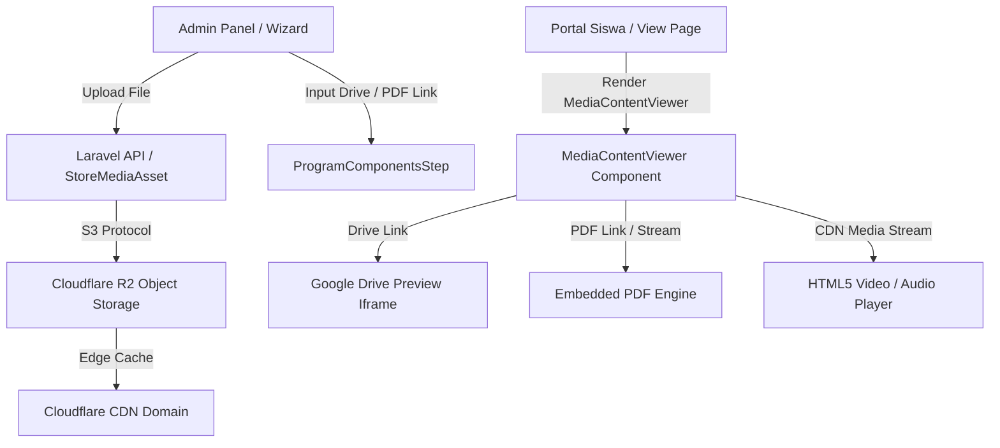

# Developer Guide: Cloudflare CDN Media Architecture & View Page Engine

Panduan teknis bagi pengembang mengenai arsitektur pengelolaan media berbasis **Cloudflare R2 Storage & CDN**, pustaka pembantu yang dapat digunakan kembali (*reusable library*), dan mesin rendering **View Page interaktif** (*Google Drive, PDF, Media Player*).

---

## 1. Arsitektur Komponen



---

## 2. Backend Laravel: `CloudflareMediaService`

Layanan inti terletak pada [`App\Support\Media\CloudflareMediaService`](file:///d:/project/ams/apps/api/app/Support/Media/CloudflareMediaService.php):

### Metode Utama

| Metode | Deskripsi |
| :--- | :--- |
| `isConfigured(): bool` | Memeriksa apakah disk Cloudflare R2 atau CDN domain telah aktif di lingkungan aplikasi. |
| `getDisk(bool $isPublic): string` | Mengambil nama disk aktif (`cloudflare-r2-public` atau `cloudflare-r2-private`). |
| `getPublicDisk(): string` | Mengambil nama disk publik (`cloudflare-r2-public`). |
| `getPrivateDisk(): string` | Mengambil nama disk privat (`cloudflare-r2-private`). |
| `getCdnUrl(?string $objectKey, ?string $disk): ?string` | Menghasilkan URL publik berakselerasi CDN edge untuk suatu object key. |
| `upload(UploadedFile $file, string $dir, array $opts): array` | Mengunggah berkas ke storage Cloudflare R2, menghitung SHA-256 checksum, dan menghasilkan metadata lengkap. |
| `uploadPublic(UploadedFile $file, string $dir, array $opts): array` | Helper khusus mengunggah berkas publik (foto profil, thumbnail, logo). |
| `uploadPrivate(UploadedFile $file, string $dir, array $opts): array` | Helper khusus mengunggah berkas privat (dokumen pribadi, materi kursus privat). |
| `delete(string $objectKey, ?string $disk): bool` | Menghapus berkas dari storage. |
| `createStreamResponse(...): StreamedResponse` | Menghasilkan respons streaming dengan `Content-Disposition: inline` (untuk pratinjau View Page) atau `attachment` (untuk unduhan) serta header caching optimal. |

### Konfigurasi `.env`

```env
# Cloudflare R2 & CDN Dual-Bucket Configuration (APAC)
CLOUDFLARE_R2_ENABLED=true
CLOUDFLARE_R2_ACCOUNT_ID=13186a6d991d58c1204634129a35ea3c
CLOUDFLARE_R2_ENDPOINT=https://13186a6d991d58c1204634129a35ea3c.r2.cloudflarestorage.com
CLOUDFLARE_R2_REGION=auto
CLOUDFLARE_R2_ACCESS_KEY_ID=your_access_key_id
CLOUDFLARE_R2_SECRET_ACCESS_KEY=your_secret_access_key

# Bucket Publik (Foto profil, gambar produk, thumbnail, banner, logo)
CLOUDFLARE_R2_PUBLIC_BUCKET=public-files
CLOUDFLARE_R2_PUBLIC_URL=https://pub-043d267920b64ff7b8d21410e443f7ee.r2.dev
CLOUDFLARE_CDN_URL=https://pub-043d267920b64ff7b8d21410e443f7ee.r2.dev

# Bucket Privat (Dokumen pengguna, lampiran pengajuan, berkas materi kursus)
CLOUDFLARE_R2_PRIVATE_BUCKET=private-files
COMPONENT_MEDIA_DISK=cloudflare-r2-private
```

---

## 3. Frontend Next.js: Reusable Library `@/lib/media.ts`

Pustaka ini dapat diimpor dan digunakan kembali di seluruh aplikasi web [`apps/web/src/lib/media.ts`](file:///d:/project/ams/apps/web/src/lib/media.ts):

### Fungsi-Fungsi Utama

1. `parseGoogleDriveUrl(url: string)`:
   - Mendeteksi tautan Google Drive: `/file/d/{id}/view`, `/document/d/{id}/edit`, `/spreadsheets/d/{id}/edit`, `/presentation/d/{id}/edit`, `/open?id={id}`, atau `/drive/folders/{id}`.
   - Otomatis mengonversi ke tautan sematan aman: `https://drive.google.com/file/d/{id}/preview`.
   - Mengembalikan objek `GoogleDriveInfo` berisi flag `isGoogleDrive`, `previewUrl`, dan tipe dokumen.

2. `isPdfUrl(url: string)`:
   - Memeriksa apakah URL berakhiran `.pdf` atau merepresentasikan dokumen PDF.

3. `resolveMediaViewerData({ title, externalUrl, mediaAsset })`:
   - Menganalisis parameter konten dan menentukan jenis tampilan yang tepat (`'google_drive' | 'pdf' | 'video' | 'audio' | 'image' | 'external_link' | 'download_only'`).
   - Menyediakan `previewUrl`, `downloadUrl`, label badge, dan flag `isEmbeddable`.

4. `uploadMediaToCloudflare(programId, file, reason, onProgress)`:
   - Helper untuk mengunggah berkas media ke API dengan tracking progress bar (`0% - 100%`).

---

## 4. Komponen Antarmuka: `MediaContentViewer.tsx`

Komponen UI modular berbasis **Glassmorphism** [`apps/web/src/components/shared/MediaContentViewer.tsx`](file:///d:/project/ams/apps/web/src/components/shared/MediaContentViewer.tsx):

### Props

```typescript
interface MediaContentViewerProps {
  title?: string;
  externalUrl?: string | null;
  mediaAsset?: WorkspaceMediaAsset | null;
  className?: string;
  defaultHeight?: number | string; // default: 620
  showDownloadButton?: boolean;
  onDownload?: () => void;
  isDownloading?: boolean;
}
```

### Fitur Desain & Performa
- **Styling Glass**: Menerapkan `backdrop-blur-xl bg-white/70 dark:bg-zinc-950/70` dengan border semi-transparan `border-white/20 dark:border-white/10`.
- **Fullscreen API**: Dukungan layar penuh bawaan peramban (*browser fullscreen*) yang responsif.
- **Lazy Loading**: Bingkai iframe dan pemutar video dimuat secara *lazy* untuk efisiensi memori dan waktu muat awal halaman yang cepat.
- **Fallback Toleran Kesalahan**: Menampilkan pesan informatif jika tautan Google Drive berstatus *private* atau dibatasi oleh pemiliknya.

---

## 5. Integrasi Siswa: `ComponentContentRenderer.tsx`

Pada [`ComponentContentRenderer.tsx`](file:///d:/project/ams/apps/web/src/components/workspace/ComponentContentRenderer.tsx), sistem memeriksa secara otomatis:
- Jika `external_url` adalah Google Drive atau PDF langsung, atau jika terdapat `media_asset` bertipe PDF/Video, komponen secara cerdas beralih dari tombol tautan biasa menjadi **MediaContentViewer interaktif**.
- Siswa tidak lagi dialihkan keluar dari aplikasi web saat ingin membaca materi atau melihat slide.
