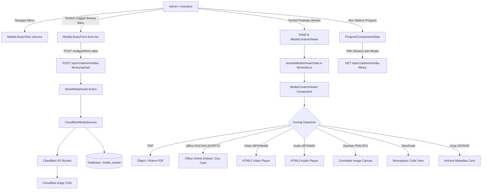

# Panduan Pengembang: Media Library & Integrasi Program Components

Dokumen panduan teknis pengembang untuk implementasi fitur **Media Library** terpusat, pemisahan modular antara **View & Form**, sistem penampil pratinjau format-spesifik (**Format-Specific Media Viewer**), serta integrasi dengan **Program Components Step** dan arsitektur penyimpanan **Cloudflare R2 Storage & Edge CDN**.

---

## 1. Arsitektur & Alur Kerja

Media Library di Arkanin Management System (AMS) mengadopsi model **Hybrid Centralized & Program-Scoped** dengan pemisahan tegas antara komponen eksplorasi (*View*) dan komponen pengunggahan (*Form*):



### Keunggulan Pemisahan View & Form
1. **Single Responsibility Principle**: `view.tsx` bertanggung jawab atas agregasi data, metrik kapasitas, filter, pencarian, dan penampil detail, sedangkan `form.tsx` fokus pada penanganan input, validasi berkas, drag & drop, serta pengunggahan *real-time*.
2. **Reusability**: `MediaLibraryForm` dapat digunakan kembali sebagai dialog popup modal, form halaman mandiri, atau disematkan di dalam alur wizard lain.
3. **Optimasi Performa & Render**: Perubahan *state* pengunggahan berkas (seperti persentase progres unggah dan drag-over) tidak memicu *re-render* yang tidak perlu pada tabel atau grid aset di `view.tsx`.

---

## 2. Struktur Database & Audit Trail

Tabel `media_assets` dimigrasikan untuk mendukung Media Library pusat dengan field audit trail lengkap:

| Kolom | Tipe | Nullable | Keterangan |
| :--- | :--- | :---: | :--- |
| `id` | `bigint unsigned` | Tidak | Primary key |
| `program_id` | `bigint unsigned` | Ya | Foreign key ke `programs.id` (`NULL` untuk aset global) |
| `folder` | `varchar(100)` | Ya | Kategori folder (misal: `materials`, `documents`, `curriculum`, `slides`) |
| `original_name` | `varchar(255)` | Tidak | Nama asli berkas |
| `storage_path` | `varchar(255)` | Tidak | Path relatif pada bucket R2 |
| `storage_disk` | `varchar(50)` | Tidak | Disk driver (`cloudflare_r2` atau `cloudflare_r2_public`) |
| `mime_type` | `varchar(100)` | Tidak | MIME type berkas |
| `extension` | `varchar(20)` | Tidak | Ekstensi file |
| `size_bytes` | `bigint unsigned` | Tidak | Ukuran berkas dalam bytes |
| `checksum_sha256` | `varchar(64)` | Ya | Hash SHA-256 untuk verifikasi integritas berkas |
| `cdn_url` | `text` | Ya | URL publik CDN Cloudflare jika menggunakan bucket publik |
| `created_by` | `bigint unsigned` | Ya | User ID pengunggah berkas |
| `updated_by` | `bigint unsigned` | Ya | User ID pengubah terakhir |
| `created_at` | `timestamp` | Ya | Waktu unggah awal berkas |
| `updated_at` | `timestamp` | Ya | Waktu pembaruan berkas terakhir |
| `deleted_at` | `timestamp` | Ya | Soft delete timestamp |

---

## 3. Penampil Pratinjau Format-Spesifik (`MediaContentViewer`)

Deteksi dan resolusi format dilakukan melalui helper `resolveMediaViewerData()` pada [`apps/web/src/lib/media.ts`](file:///d:/project/ams/apps/web/src/lib/media.ts) yang mengembalikan tipe `MediaViewerData`:

```typescript
export type MediaViewKind =
  | 'google_drive'
  | 'pdf'
  | 'video'
  | 'audio'
  | 'image'
  | 'office'       // Word, Excel, PowerPoint
  | 'text'         // TXT, JSON, MD, XML, Code
  | 'archive'      // ZIP, RAR, 7Z, TAR
  | 'external_link'
  | 'download_only';
```

### Logika Resolusi Viewer per Format
1. **PDF**: `isPdf` memeriksa ekstensi `.pdf` atau MIME `application/pdf`. Dirender menggunakan elemen `<object>` dengan *fallback* `<iframe>` dan toolbar navigasi halaman.
2. **Microsoft Office Documents**:
   - Word (`.docx`, `.doc`, `.rtf`), Excel (`.xlsx`, `.xls`, `.csv`), PowerPoint (`.pptx`, `.ppt`).
   - Jika berkas memiliki URL publik CDN Cloudflare, disematkan langsung menggunakan **Microsoft Office Online Viewer**:
     `https://view.officeapps.live.com/op/embed.aspx?src=${encodeURIComponent(cdnUrl)}`.
   - Dilengkapi *fallback* kartu interaktif dengan metadata berkas, tombol buka di Office Online, dan tombol unduh.
3. **Video**: `mime.startsWith('video/')` atau ekstensi `.mp4`, `.webm`, `.mov`. Dirender dengan elemen `<video controls playsInline>`.
4. **Audio**: `mime.startsWith('audio/')` atau ekstensi `.mp3`, `.wav`, `.m4a`, `.ogg`. Dirender dengan `<audio controls>` dan kartu pemutar audio.
5. **Gambar**: `mime.startsWith('image/')`. Dilengkapi kontrol interaktif `ZoomIn` (+25%), `ZoomOut` (-25%), tampilan persentase (50% - 300%), dan `Reset Zoom`.
6. **Teks & Kode**: Ekstensi `.txt`, `.json`, `.md`, `.xml` atau MIME `text/*`. Dirender di dalam bingkai kontainer monospaced.
7. **Arsip Terkompresi**: Ekstensi `.zip`, `.rar`, `.7z`. Dirender berupa kartu inspeksi arsip dengan informasi ukuran dan tombol unduh aman.

---

## 4. Komponen Frontend

### A. Media Library View (`apps/web/src/components/admin/views/MediaLibrary/view.tsx`)
- Menampilkan kartu metrik penyimpanan real-time: Total Berkas, Kapasitas Storage, Status Edge CDN, dan Program Terhubung.
- Menampilkan bar kontrol dengan pencarian, filter program, filter tipe berkas, filter folder, serta toggle mode tampilan (Grid & Tabel).
- Mengintegrasikan modal unggah yang membungkus komponen terpisah `<MediaLibraryForm />`.
- Menyediakan modal detail pratinjau lengkap dengan `MediaContentViewer`, kartu teknis & audit trail (SHA-256 hash, pengunggah, tanggal dibuat/diperbarui, storage disk, tombol salin CDN, tombol unduh, dan tombol hapus).

### B. Media Library Form (`apps/web/src/components/admin/views/MediaLibrary/form.tsx`)
- Modul formulir mandiri dengan antarmuka bergaya *Glassmorphism*.
- Area interaktif Drag & Drop berkas dengan deteksi ikon format file visual.
- Pilihan penautan ke program pembelajaran atau penetapan sebagai berkas global.
- Input folder kategori dengan tombol rekomendasi cepat (`materials`, `documents`, `curriculum`, `slides`, `videos`, `audio`, `exams`).
- Input alasan pengunggahan untuk kebutuhan log audit.
- Bar visual progres unggah bertenaga Cloudflare R2 API.

### C. Program Components Step (`apps/web/src/components/admin/views/Programs/ProgramComponentsStep.tsx`)
- Modal pemilih Media Library terintegrasi dengan tab "Semua Media Library" dan "Program Ini".
- Fitur pencarian instan dan tombol aksi cepat "Unggah Baru & Tautkan Langsung".
- Setiap berkas yang dipilih langsung mengisi `media_asset_id`, nama, ukuran, dan URL CDN pada komponen silabus program.

---

## 5. Konfigurasi Cloudflare CDN & R2

Konfigurasi lingkungan pada `apps/api/.env`:

```env
CLOUDFLARE_R2_ACCOUNT_ID=13186a6d991d58c1204634129a35ea3c
CLOUDFLARE_R2_BUCKET=private-files
CLOUDFLARE_R2_PUBLIC_BUCKET=public-files
CLOUDFLARE_R2_URL=https://13186a6d991d58c1204634129a35ea3c.r2.cloudflarestorage.com
CLOUDFLARE_R2_PUBLIC_URL=https://pub-043d267920b64ff7b8d21410e443f7ee.r2.dev
CLOUDFLARE_CDN_URL=https://pub-043d267920b64ff7b8d21410e443f7ee.r2.dev
```
