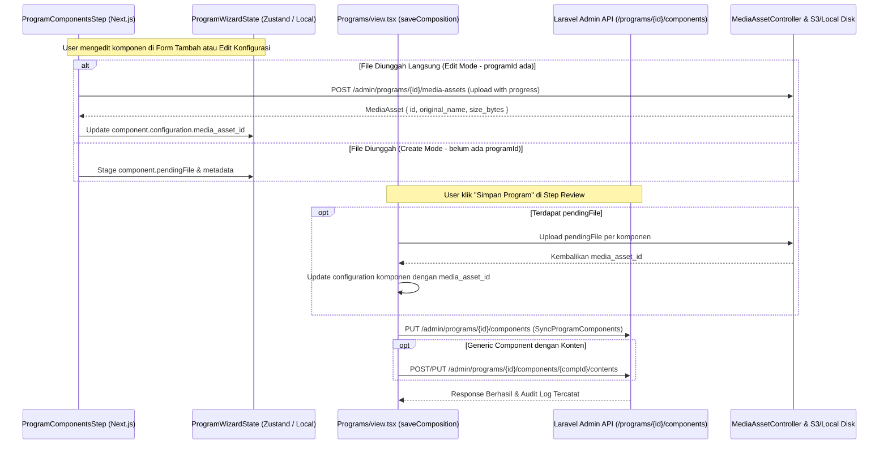

# Developer Guide: Arsitektur Pengelolaan Konten Komponen Langsung (Program Wizard)

Panduan teknis dan referensi arsitektur sistem bagi tim pengembang untuk implementasi pengelolaan konten komponen secara terintegrasi pada wizard program AMS.

---

## 1. Arsitektur Komponen & Data Flow

Pengelolaan konten komponen terintegrasi pada 3 lapisan utama sesuai **PRD AMS Admin Menus 4-Layer CBT Architecture**:



---

## 2. Struktur Data Konfigurasi Komponen (`JSONB`)

Komponen program menyimpan seluruh parameter konten di dalam atribut `configuration: Record<string, unknown>` pada tabel `program_components`:

```typescript
export type ComponentContentType = 'file' | 'video_url' | 'text' | 'link';

export interface ComponentContentConfig {
  content_type?: ComponentContentType;
  title?: string;
  summary?: string;
  body?: string;
  external_url?: string;
  media_asset_id?: number | null;
  media_name?: string;
  media_size?: number;
  duration_minutes?: number;
  is_published?: boolean;
  is_preview?: boolean;
}
```

### Validasi Batasan Payload (Backend)
- Kelas validator: `App\Support\Components\ComponentConfigValidator.php`
- Batas maksimal ukuran JSON: 16 KB (`MAX_CONFIG_BYTES`)
- Batas kedalaman rekursi: 8 tingkat (`MAX_CONFIG_DEPTH`)
- Batas total node array: 500 simpul (`MAX_CONFIG_NODES`)

---

## 3. Komponen Frontend Kunci

| Berkas | Tanggung Jawab Teknis |
| :--- | :--- |
| `ProgramComponentsStep.tsx` | Antarmuka pemilihan jenis materi, dropzone unggah berkas, pemilih Media Library, preview file, dan lencana ringkasan status. |
| `wizard-types.ts` | Definisi tipe `ComponentContentType`, `ComponentContentConfig`, dan ekstensi `ProgramComponentDraft`. |
| `view.tsx` | Eksekusi `saveComposition`: mengunggah berkas `pendingFile`, menyinkronkan komponen program, dan menyinkronkan `program_component_contents`. |
| `lib/api.ts` | Klien API untuk `mediaAssets.list`, `mediaAssets.upload`, `mediaAssets.remove`. |

---

## 4. Endpoint Backend Terkait

- `GET /api/v1/admin/programs/{program}/media-assets`: Mengambil daftar media asset privat milik program (`MediaAssetController@index`).
- `POST /api/v1/admin/programs/{program}/media-assets`: Mengunggah berkas privat baru (`MediaAssetController@store`).
- `PUT /api/v1/admin/programs/{program}/components`: Menyinkronkan seluruh komponen dan konfigurasi JSONB (`ProgramComponentController@update`).
- `GET/POST/PUT /api/v1/admin/programs/{program}/components/{component}/contents`: CRUD konten generic komponen (`ProgramComponentContentController`).
