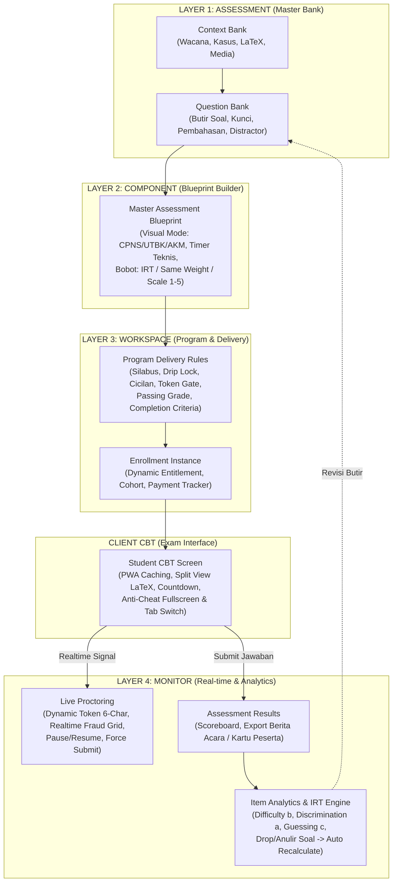
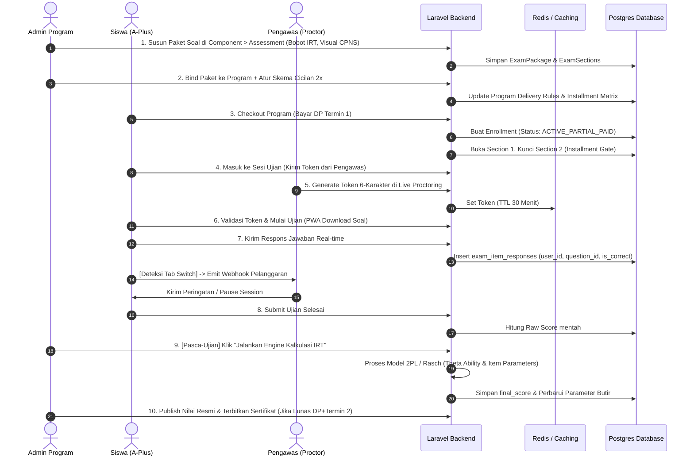
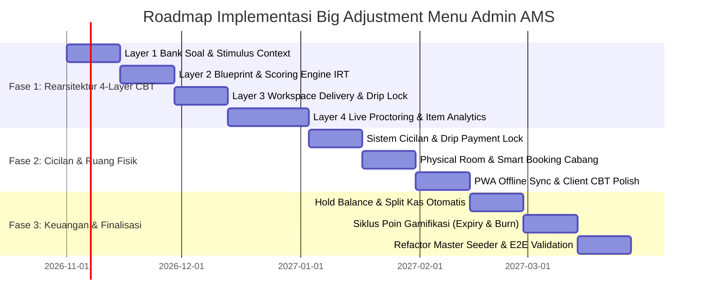

# Product Requirements Document (PRD)
# Arkanin Management System (AMS) – Master Admin Menu & 4-Layer Architecture (Big Adjustment)

| Metrik Dokumen | Deskripsi Spesifikasi |
| :--- | :--- |
| **Dokumen** | `PRD-ams-admin-menus.md` |
| **Versi** | 2.0.0 (Big Adjustment Release) |
| **Status** | Disetujui (Approved / Living Specification) |
| **Tanggal Terbit** | 2026-10-26 |
| **Penulis / Reviewer** | Lead Product Architect & System Engineering Arkanin |
| **Rujukan Konsep** | [Arkanin Management System 1e0117c3d984802e9312c53770fbf041.md](file:///d:/Project/Arkanin_v1/docs/Arkanin%20Management%20System%201e0117c3d984802e9312c53770fbf041.md) & [2026-09-21-PRD-ekosistem-dan-mekanisme-baru.md](file:///d:/Project/Arkanin_v1/docs/plans/2026-09-21-PRD-ekosistem-dan-mekanisme-baru.md) |
| **Target Host** | `lms.arkanin.my.id` (Aplikasi Admin & Workspace), `arkanin.my.id` (Landing Page & Publik) |

---

## 1. Executive Summary

### 1.1 Problem Statement
Arsitektur panel admin AMS sebelumnya mengalami penumpukan tanggung jawab (*variable crowding*) pada modul `Component > Assessment`, di mana perancangan bank soal, perakitan blueprint ujian, pembatasan akses program, hingga kontrol pengawasan lapangan (*proctoring*) tercampur dalam satu antarmuka yang tidak terstruktur. Selain itu, ketiadaan mekanisme cicilan fleksibel (*installment lock*), belum terintegrasinya alur psikometrik pasca-ujian (*IRT / Classical Item Analysis*), ketiadaan penanganan ketahanan luring (*PWA offline test caching*), serta minimnya pemisahan kas instan (*financial revenue splitting*) menyebabkan inefisiensi koordinasi lintas cabang dan risiko distorsi integritas data evaluasi belajar.

### 1.2 Proposed Solution
Melakukan *Big Adjustment* terstruktur pada seluruh ekosistem navigasi dan operasional Admin AMS dengan membagi sistem penilaian & pembelajaran menjadi **Arsitektur 4-Layer CBT**:
1. **Layer 1: Assessment (Master Bank)** – Pengelolaan wacana/stimulus (*Context Bank*) dan butir pertanyaan (*Question Bank*).
2. **Layer 2: Component (Blueprint Package Builder)** – Perakitan paket soal, visual mode (CPNS/UTBK/AKM), timer teknis, dan rumus penskoran IRT/Same Weight/Scale.
3. **Layer 3: Workspace (Program & Delivery Execution)** – Pengikatan blueprint ke dalam silabus terstruktur, *Dynamic Entitlement*, sistem cicilan (*drip access lock*), passing grade, dan kriteria sertifikasi otomatis.
4. **Layer 4: Monitor (Live Proctoring & Item Analytics)** – Pengawasan token dinamis real-time, deteksi kecurangan tab switch, anulir soal (*drop question*), serta rekalibrasi statistik IRT pasca-ujian.

Didukung oleh standarisasi 13 Kategori Menu Admin AMS yang memuat modul operasional jadwal fisik/ruangan, manajemen pencairan dana (*hold balance*), pembagian kas otomatis (*revenue split*), serta siklus hidup poin (*burn & expiry*).

### 1.3 Success Criteria (Measurable KPIs)
1. **Exam Delivery Reliability & Zero Data Loss**: 100% jawaban peserta tersimpan secara aman dengan dukungan sinkronisasi otomatis (*IndexedDB PWA offline-to-online sync*) dalam $\le 2$ detik setelah koneksi pulih.
2. **Proctoring Anomaly Detection Rate**: $\ge 98\%$ insiden pergantian tab (*tab switch*), keluar dari mode layar penuh, atau anomali jaringan terdeteksi dan tercatat di *Live Proctoring Grid* dalam latency $< 500\text{ ms}$.
3. **Psychometric Recalculation Speed**: Eksekusi mesin analitik butir soal IRT/Classical untuk 1.000 peserta dengan 100 nomor soal selesai dalam waktu $< 15$ detik.
4. **Automated Financial Reconciliation**: $100\%$ pemotongan saldo penarikan (*withdrawal*) menerapkan mekanisme *Hold Balance*, dan alokasi bagi hasil (Honor Mentor, Operasional Cabang, Kas Pusat) terdistribusi otomatis seketika sesi divalidasi.
5. **Page Navigation & Render Latency**: Tampilan antarmuka Admin (Next.js Glassmorphism UI) merespons transisi menu dalam waktu $< 200\text{ ms}$ pada dataset 10.000 entitas.

---

## 2. User Experience & Functionality

### 2.1 User Personas
1. **Super Admin / Direktur (Pusat)**: Mengatur tata kelola global, master skema biaya, penutupan tahun buku, audit sistem, dan konfigurasi pohon menu dinamis.
2. **Manajer Cabang & Admin Operasional (Branch / ASA)**: Mengelola kuota ruangan fisik (*Physical Room*), mencocokkan ketersediaan tentor (*Available Time Matcher*), mengawasi presensi, dan memvalidasi sertifikat manual.
3. **Pengawas Ujian (Proctor)**: Memantau jalannya tes secara real-time via *Live Proctoring*, merilis token 6-karakter dinamis, memberikan dispensasi waktu tambahan, atau melakukan *force submit*.
4. **Penyusun Soal / Mentor Ahli**: Menginput soal kaya LaTeX/gambar di *Question Bank*, mereview daya beda butir soal di *Item Analytics*, dan membuka ketersediaan jadwal mengajar.
5. **Admin Keuangan (ASD)**: Memverifikasi bukti pembayaran cicilan, menyetujui pengajuan pencairan dana mentor (*Hold to Released*), dan menerbitkan faktur/slip honor.
6. **Student (A-Plus)**: Mengerjakan ujian CBT dalam antarmuka terstandarisasi, melakukan reservasi jadwal bimbingan, memantau kemajuan cicilan, dan mengklaim sertifikat.
7. **Parent (Akun Orang Tua)**: Memantau rapor hasil belajar, grafik kehadiran sesi offline/online, dan status pembayaran cicilan anak.

---

### 2.2 Arsitektur Rearsitektur 4-Layer CBT & Evaluasi



---

### 2.3 User Stories & Acceptance Criteria

#### Epik 1: Master Bank Soal & Stimulus (Layer 1)
- **Story 1.1**: Sebagai *Penyusun Soal*, saya ingin mengelompokkan beberapa soal ke dalam satu wacana utama (*Context*) agar soal berbasis studi kasus/bacaan panjang tidak berulang dan tertata rapi.
  - **Acceptance Criteria**:
    - Context mendukung teks kaya (Markdown, HTML, rumus TeX/LaTeX via KaTeX, dan sisipan gambar/audio).
    - Butir soal (*Question*) dapat ditautkan ke satu `context_id` (relasi 1-to-N).
    - Tersedia indikator estimasi waktu per soal (*estimated seconds*) dan tingkat kesulitan (Mudah, Sedang, Sulit, HOTS).
- **Story 1.2**: Sebagai *Mentor*, saya ingin memasukkan usulan soal ke Bank Soal dengan status review agar saya memperoleh Poin Gamifikasi saat soal disetujui.
  - **Acceptance Criteria**:
    - Siklus status soal: `Draft` $\rightarrow$ `Under Review` $\rightarrow$ `Approved` (Poin mentor bertambah) / `Revision Needed`.

#### Epik 2: Blueprint Assessment Builder (Layer 2)
- **Story 2.1**: Sebagai *Admin Akademik*, saya ingin merangkai blueprint paket ujian dengan visual mode spesifik dan pengaturan sub-tes berjeda (*intermission break*).
  - **Acceptance Criteria**:
    - Pilihan antarmuka pengerjaan: `Standard`, `CPNS (SKD/SKB)`, `UTBK/SNBT`, `AKM`, `OSN`, `OMI`.
    - Struktur multi-seksi mendukung mode `Direct Continuous` (langsung lanjut) atau `Intermission Break` (jeda terhitung sebelum sub-tes berikutnya).
    - Dukungan Drag & Drop untuk pengurutan seksi dan penentuan slot soal per sub-tes.
- **Story 2.2**: Sebagai *Admin Akademik*, saya ingin memilih metode penskoran (Same Weight, Custom Weight, Skala 1–5 TKP, atau IRT) serta aturan nilai minus (*negative marking*).
  - **Acceptance Criteria**:
    - Mode `Same Weight`: input nilai tunggal per soal.
    - Mode `Custom Weight`: input bobot per butir soal.
    - Mode `Scale Score (TKP)`: input bobot 1–5 untuk masing-masing opsi pilihan A, B, C, D, E.
    - Mode `Negative Marking`: toggle penalti (+4 Benar, -1 Salah, 0 Kosong).
    - Komponen *Sticky Summary Bar* menampilkan total skor maksimal, estimasi waktu paket, dan kelengkapan kunci secara real-time.

#### Epik 3: Delivery Program, Dynamic Entitlement & Cicilan (Layer 3)
- **Story 3.1**: Sebagai *Admin Program*, saya ingin mengonfigurasi skema cicilan (*installment*) pada program berbayar agar siswa dapat mencicil tanpa akses materi terlewat.
  - **Acceptance Criteria**:
    - Admin dapat menentukan nominal DP (Termin 1) dan jumlah termin berikutnya beserta pemicu tanggal jatuh tempo (*Due Date*).
    - Pembayaran Termin 1 otomatis membuka Section 1 dan sesi jadwal awal.
    - Jika Termin 2 melewati batas jatuh tempo dan belum lunas, Section 2 ke atas dan link sesi meeting offline/online otomatis terkunci (`Locked - Installment Due`).
    - Sertifikat program diblokir dari penerbitan hingga status pembayaran di menu Enrollment berstatus `Fully Paid`.
- **Story 3.2**: Sebagai *Siswa*, saya ingin melihat pratinjau silabus kurikulum dengan materi terkunci (*Dynamic Paywall*) sebelum melakukan pendaftaran.
  - **Acceptance Criteria**:
    - Katalog program menampilkan struktur pohon kurikulum lengkap; materi berbayar diberi ikon gembok dengan tombol CTA pendaftaran/pembelian.
- **Story 3.3**: Sebagai *Admin Enrollment*, saya ingin memantau checklist pemenuhan kelulusan siswa secara individual.
  - **Acceptance Criteria**:
    - Matriks pemantauan menampilkan 4 parameter: Progres Materi (Min. 100%), Kehadiran Sesi (Min. 80%), Nilai CBT ($\ge$ Passing Grade), dan Kuisioner Evaluasi (Wajib diisi).

#### Epik 4: Live Proctoring, Evaluasi & Analisis Butir IRT (Layer 4)
- **Story 4.1**: Sebagai *Pengawas Ujian (Proctor)*, saya ingin memantau ujian secara langsung dengan sistem token acak yang disegarkan berkala.
  - **Acceptance Criteria**:
    - Generator token 6-karakter acak dengan timer auto-refresh (misal 30 menit).
    - Grid live status peserta: `Mengerjakan` (Hijau), `Pindah Tab` (Merah berkedip + counter jumlah switch), `Terputus` (Kuning), `Selesai` (Biru).
    - Tombol aksi pengawas: `Pause/Resume Sesi`, `Force Submit`, dan `Beri Tambahan Waktu` (+10 menit).
- **Story 4.2**: Sebagai *Analisis Mutu Pendidikan*, saya ingin menjalankan kalkulasi statistik IRT/Classical pasca-ujian dan dapat menganulir butir soal yang cacat (*drop question*).
  - **Acceptance Criteria**:
    - Tombol aksi: `[ Jalankan Engine Kalkulasi IRT ]`.
    - Perhitungan estimasi parameter: Tingkat Kesukaran ($b$), Daya Beda ($a$), dan Tebakan Acak ($c$) beserta label verbal (*Sangat Baik / Fit / Unfit*).
    - Opsi tombol `[ Anulir / Drop Soal ]` yang mengecualikan butir soal cacat dan memicu `[ Recalculate IRT ]` otomatis.
    - Tombol `[ Publish Nilai Resmi ]` untuk merilis skor akhir hasil konversi ($\theta$) ke portal siswa.

#### Epik 5: Tata Kelola Operasional Cabang & Keuangan
- **Story 5.1**: Sebagai *Admin Cabang*, saya ingin mengatur inventaris ruang fisik (*Physical Room*) dan mencocokkan jadwal luang tentor (*Smart Matcher*).
  - **Acceptance Criteria**:
    - Manajemen ruang per cabang memuat nama ruang, tipe kelas, kapasitas maksimal, dan status ketersediaan kursi.
    - Sistem booking menyaring mentor dan siswa yang berada pada cabang fisik yang sama (*Same Branch Filter*).
- **Story 5.2**: Sebagai *Admin Keuangan*, saya ingin sistem menahan saldo pencairan (*Hold Balance*) agar tidak terjadi penarikan ganda (*double spending*).
  - **Acceptance Criteria**:
    - Saat pengajuan penarikan honor mentor dibuat, saldo berstatus `Hold`. Saldo benar-benar terdebit dari sistem saat admin mengklik `Approve Withdrawal`.
    - Sistem mencatat pemisahan alokasi dana otomatis: Honor Mentor, Operasional Cabang, dan Kas Pusat pasca validasi sesi.

---

### 2.4 Non-Goals (Batasan Luar Ruang Lingkup)
1. **Bukan Sistem Video Conference Mandiri**: Sistem tidak membangun server WebRTC/Zoom in-house; integrasi dilakukan via tautan terenkripsi (Zoom, Google Meet, YouTube Live Embed).
2. **Bukan Gateway Pembayaran Mandiri**: Transaksi online diproses melalui aggregator pihak ketiga (Midtrans / Xendit / Flip Business); AMS hanya mengelola webhook, verifikasi mutasi, dan pencatatan buku besar (*General Ledger*).
3. **Bukan Sistem Koreksi Esai Otomatis dengan AI Generatif Tanpa Verifikasi**: Koreksi soal esai tetap membutuhkan tinjauan manusia (*Inter-Rater Reliability*); AI hanya dapat memberikan saran skor awal jika diaktifkan.

---

## 3. Spesifikasi Detail 13 Kategori Master Menu Admin AMS (Versi 2.0.0)

Berikut adalah standarisasi seluruh kategori menu, sub-menu, rute internal, status implementasi, dan alur integrasi perannya:

| Kategori Utama | Sub-Menu | Route URL | Status | Model / Entitas Backend | Deskripsi & Alur Lemparan (*Dispatch Flow*) |
| :--- | :--- | :--- | :---: | :--- | :--- |
| **1. Dashboard** | Global Overview | `admin://view/dashboard` | 🟢 Ready | `AuditLog`, Agregasi Metrik | Ringkasan metrik ekosistem real-time, grafik omzet, performa cabang, dan log anomali. |
| **2. Personal** | Role & Permission | `admin://view/roles` | 🟢 Ready | `roles`, `permissions` | Matriks RBAC Spatie & mekanisme *Active Role Switching* (konteks sesi token tanpa menghapus hak baku). |
| | Branch (Cabang) | `admin://view/branches` | 🟡 Partial | `Branch` | Pengelolaan kantor cabang: metrik murid, mentor, jam terbang, dan isolasi data per cabang (`branch_id`). |
| | User & Parent | `admin://view/users` | 🟢 Ready | `User`, `UserProfile`, `ParentStudentRelation` | Master akun pengguna, status suspend/verifikasi, impersonasi, dan relasi akun orang tua (*Parental Portal*). |
| | Mentor Management | `admin://view/mentors` | 🟢 Ready | `Mentor`, `MentorApplication` | Pipeline seleksi mentor (`Applied` $\rightarrow$ `Interview` $\rightarrow$ `Hired`), upload berkas CV, profil keahlian, dan bank soal mentor. |
| **3. Landing Page** | Content Page | `admin://view/cms-pages` | 🟡 Partial | `Page`, `Post`, `Article` | Manajemen publikasi artikel blog, syarat ketentuan, dan artikel premium bertingkat (*Subscription*). |
| | Layout Page | `admin://view/landing-layout` | 🔴 Planned | `LandingSection`, `BannerPromotion` | Visual composer beranda: hero banner promosi, katalog showcase, popup pengumuman, dan integrasi link blogspot. |
| **4. Master Assessment** | Context Bank | `admin://view/assessment-contexts` | 🟡 Partial | `AssessmentContext`, `ContextMedia` | **Layer 1 CBT**: Bank stimulus/wacana, studi kasus, teks kaya, rumus LaTeX, gambar, dan klip audio. |
| | Question Bank | `admin://view/assessment-questions` | 🟡 Partial | `Question`, `QuestionOption`, `QuestionExplanation` | **Layer 1 CBT**: Bank soal multi-format (PG, Kompleks, Skala Likert 1-5, Esai), kunci jawaban, tagging topik, dan distractor. |
| **5. Schedule Tool** | Available Time | `admin://view/schedule-available-time` | 🟡 Partial | `MentorAvailableTime`, `ScheduleSlot` | Pengaturan slot waktu bimbingan tentor, pembuatan bulk slot, dan pengajuan jam mengajar oleh mentor. |
| | Physical Room | `admin://view/schedule-physical-room` | 🔴 Planned | `PhysicalRoom`, `BranchRoomAsset` | Inventaris ruangan kelas per cabang: nomor ruang, kapasitas maksimal, AC/proyektor, dan pemantauan ketersediaan kursi. |
| **6. Component Tool** | Media Library | `admin://view/media-library` | 🟡 Partial | `MediaAsset`, `MediaFolder` | Penyimpanan materi pembelajaran digital (Video player, PDF viewer, Slide), durasi estimasi, dan proteksi unduh. |
| | Assessment Blueprint | `admin://view/component-assessments` | 🟡 Partial | `ExamPackage`, `ExamSection`, `AssessmentRule` | **Layer 2 CBT**: Master Package Builder (Visual Mode CPNS/UTBK, multi-seksi berjeda, scoring engine, timer pengunci). |
| | Certificate Template | `admin://view/component-certificates` | 🟡 Partial | `CertificateTemplate`, `CertificateSerial` | Perancangan master template sertifikat, penomoran otomatis (`ARK/PRG/{YEAR}/{MONTH}/{ID}`), dan validitas. |
| | Forum Link | `admin://view/component-forums` | 🔴 Planned | `ProgramForumLink`, `CohortCommunity` | Integrasi grup WhatsApp/Telegram otomatis pasca enrollment siswa ke dalam batch tertentu. |
| | Participant Rules | `admin://view/component-participants` | 🟡 Partial | `CohortGroup`, `ParticipantRule` | Pembagian kelompok batch (*cohort*), kuota maksimal kelas, aturan student leader vs member. |
| | Schedule Component | `admin://view/component-schedules` | 🟡 Partial | `ProgramSessionDefinition` | Penghubung kurikulum ke slot sesi live/offline, persentase kehadiran minimal (80%), dan kebijakan reschedule. |
| | External Link | `admin://view/component-links` | 🔴 Planned | `ResourceExternalLink` | Penyematan link referensi terkurasi (Google Drive tugas, GitHub repo, materi pendukung). |
| **7. Workspace** | Program Tag | `admin://view/tags` | 🟢 Ready | `Tag`, `TagCategory` | Taksonomi katalog program (jenjang, target tes, bidang keahlian) untuk filter pencarian katalog. |
| | Program Builder | `admin://view/programs` | 🟢 Ready | `Program`, `ProgramSection`, `ProgramInstallment` | **Layer 3 CBT**: Perancangan silabus berjenjang, aktivasi cicilan (DP/Termin), drip content lock, dan syarat kelulusan. |
| | Enrollment Manager | `admin://view/enrollments` | 🟡 Partial | `Enrollment`, `EnrollmentComponent`, `PaymentSchedule` | Pengelolaan hak aktif siswa, pelacak status cicilan (`Paid DP` $\rightarrow$ `Overdue` $\rightarrow$ `Full`), manual override, dan trigger notifikasi. |
| **8. Monitor** | Live Proctoring | `admin://view/monitor-proctoring` | 🟡 Partial | `ExamSessionToken`, `ProctorLog`, `FraudIncident` | **Layer 4 CBT**: Pusat kendali pengawasan online, token dinamis 6-karakter, deteksi switch tab, pause/resume, force submit. |
| | Assessment Sessions | `admin://view/monitor-sessions` | 🔴 Planned | `ExamRoomSession`, `SessionProctorAssignment` | Penjadwalan sesi ruang ujian fisik/online, kapasitas per sesi, dan penugasan guru pengawas. |
| | Assessment Result | `admin://view/monitor-assessment-results` | 🟡 Partial | `ExamAttempt`, `ExamAnswerMatrix` | Rekapitulasi nilai, scoreboard peserta, berita acara ujian, kartu peserta, dan ekspor data (Excel/PDF). |
| | Assessment Analysis | `admin://view/monitor-analysis` | 🔴 Planned | `ItemAnalysisReport`, `IrtParameterLog` | **Layer 4 CBT**: Analisis butir soal, estimasi parameter IRT ($b, a, c$), kurva distractor, dan tombol anulir soal (*Drop & Recalculate*). |
| | Certificate Validation | `admin://view/monitor-certificate-validation` | 🔴 Planned | `IssuedCertificate`, `CertificateApprovalQueue` | Antrean verifikasi manual persetujuan penerbitan sertifikat sebelum diunduh oleh siswa di portal. |
| | Schedule Evaluation | `admin://view/monitor-schedule-evaluations` | 🔴 Planned | `SessionAttendanceRecord`, `MentorEvaluationReview` | Rekap kehadiran siswa (QR presensi) serta formulir umpan balik dua arah (Siswa ke Mentor & Mentor ke Siswa). |
| **9. Materials** | Learning Topic | `admin://view/materials-learning-topics` | 🔴 Planned | `LearningTopicTree` | Taksonomi hierarki keilmuan untuk pemetaan kurikulum dan tagging analitik kelemahan siswa. |
| | Classification Support | `admin://view/materials-classification-support` | 🔴 Planned | `MaterialClassification` | Pengelompokan tingkat kesulitan materi (Dasar, Menengah, Mahir) dan standar jam belajar. |
| | Topic Support | `admin://view/materials-topic-support` | 🔴 Planned | `TopicSupportAsset` | Kumpulan rumus ringkas (*cheat sheet*), glosarium istilah, dan bank referensi latihan tambahan. |
| | Educational Content | `admin://view/materials-educational` | 🔴 Planned | `EducationalArticle` | Artikel motivasi, strategi menghadapi ujian seleksi, tips manajemen waktu, dan panduan belajar. |
| **10. Finance** | Voucher Discount | `admin://view/finance-vouchers` | 🔴 Planned | `VoucherDiscount`, `VoucherRedemption` | Pembuatan kupon diskon persentase/nominal, kuota batas penukaran, masa berlaku, dan kode referral mentor/afiliasi. |
| | Order Tracking | `admin://view/finance-orders` | 🟡 Partial | `Order`, `OrderItem` | Pelacakan pesanan masuk, order kedaluwarsa, status cicilan tertunda, dan verifikasi mutasi bank. |
| | Invoice Center | `admin://view/finance-invoices` | 🟡 Partial | `Invoice`, `InvoiceTaxItem` | Penerbitan bukti tagihan sah bernomor unik, breakdown pajak PPN, dan link pembayaran gateway. |
| | Transactions & Wallet | `admin://view/finance-transactions` | 🟢 Ready | `WalletTransaction`, `WithdrawalRequest` | Buku besar transaksi, deposit saldo, pemisahan kas instan, dan mekanisme penahanan saldo (*Hold Balance*). |
| | Financial Report | `admin://view/finance-reports` | 🟡 Partial | `FinancialLedgerReport` | Laporan neraca laba rugi bulanan, slip honor tentor, perputaran kas cabang, dan laporan saldo mengendap. |
| **11. Store** | E-Catalog Merchandise | `admin://view/store-catalog` | 🟡 Partial | `StoreProduct`, `ProductInventory` | Katalog barang fisik (buku modul, seragam, souvenir), penetapan harga rupiah vs poin, dan kontrol stok gudang. |
| | Gamification Point | `admin://view/store-points` | 🟡 Partial | `PointWallet`, `PointBurnPolicy` | Konfigurasi perolehan poin dari TryOut CBT, masa kedaluwarsa poin (6 bulan), serta event Flash Sale penukaran barang. |
| | Shipment Logistics | `admin://view/store-shipments` | 🔴 Planned | `ShipmentOrder`, `CourierTracking` | Input resi pengiriman ekspedisi kurir (JNE/J&T/SiCepat), ongkos kirim, dan pelacakan status sampai ke rumah. |
| **12. System** | Menu Management | `admin://view/menus` | 🟢 Ready | `Menu` | Pengaturan pohon hierarki menu admin/user, layout placement (Sidebar, Topbar, BottomNav), dan urutan drag-and-drop. |
| | Appearance & Glass | `admin://view/colorpalette` | 🟢 Ready | `ColorPalette` | Pengaturan token tema visual (Glassmorphism, Light/Dark Mode, palet warna primer/aksen). |
| | Documentation Hub | `admin://view/documentation` | 🟡 Partial | `SystemDocumentation` | Pusat panduan operasional pengguna (*user-guide*), panduan pengembang (*dev-guide*), dan spesifikasi API Markdown. |
| | Telescope Audit | `/telescope` | 🟢 Ready | Log Internal Laravel | Monitoring query database mendalam, queue jobs, exception error log, dan latency endpoint. |
| **13. Database** | Data Manager | `admin://view/database-manager` | 🔴 Planned | `DatabaseTableMetric` | Pembersihan cache kadaluwarsa, re-indeks pencarian riwayat transaksi, dan inspeksi integritas tabel. |
| | Backup & Snapshot | `admin://view/database-backup` | 🔴 Planned | `DatabaseBackupSnapshot` | Pencadangan otomatis terenkripsi harian/mingguan ke penyimpanan cloud (S3) dan pemulihan darurat (*disaster recovery*). |

---

## 4. Technical Specifications & Architecture

### 4.1 Arsitektur Data & Alur Eksekusi Terintegrasi (Online, Offline & Dynamic Self-Paced Course)
Sesuai arahan arsitektur, program tidak dipecah menjadi entitas terpisah di tingkat master, melainkan menggunakan **Unified Modular Engine** yang sepenuhnya dinamis sesuai komposisi komponen yang diinput oleh admin:
1. **Self-Paced Course (Course Biasa / Belajar Mandiri)**:
   - Jika admin **tidak menambahkan** komponen jadwal (`Schedule`), program secara otomatis berlaku sebagai **Course Biasa**.
   - Siswa bebas mengerjakan modul, video, dan asesmen kapan saja dalam rentang waktu masa aktif program (`access_lifetime`), di mana durasi akses terhitung otomatis sejak transaksi pendaftaran/pembelian berhasil dilakukan oleh calon siswa.
2. **Online Live Interactive Class**:
   - Jika admin **menambahkan komponen Schedule bertipe Online**, program otomatis beroperasi sebagai **Kelas Online Interaktif** dengan kewajiban tautan ruang virtual terenkripsi (Zoom / Google Meet / Embedded Stream).
3. **Offline On-Site Class**:
   - Jika admin **menambahkan komponen Schedule bertipe Offline**, program otomatis beroperasi sebagai **Kelas Tatap Muka Cabang** dengan keterikatan inventaris ruang fisik (`physical_room_id`), kuota kursi, dan kode cabang (`branch_id`).
4. **Blended / Hybrid Learning**:
   - Program yang memadukan materi mandiri, sesi tatap muka cabang, dan webinar daring dalam satu silabus utuh.
5. **Free-Input Tagging System**:
   - Tidak ada deklarasi tipe program kaku di formulir; admin diberikan kebebasan penuh menginput tag secara dinamis (*free input tags*). Tag baru otomatis didaftarkan ke sistem taksonomi katalog.
6. **Sistem Multi-Komponen Tambah & Toggle On/Off**:
   - Komponen kurikulum program menggunakan sistem tambah modular (`Add Component Instance`) dengan switch toggle On/Off visual (bukan checkbox tunggal).
   - Setiap tipe komponen dapat ditambahkan lebih dari satu kali (misal: *Materi 1 Teori Dasar*, *Materi 2 Studi Kasus*, *Media Rekaman*, *Tryout 1*, *Tryout 2*).




### 4.2 Database Schema Adjustments

#### 1. Modul CBT & Item Analytics (Layer 1, 2, 4)
```sql
-- Stimulus / Wacana Induk
CREATE TABLE assessment_contexts (
    id BIGSERIAL PRIMARY KEY,
    title VARCHAR(255) NOT NULL,
    body_content TEXT NOT NULL,
    media_url VARCHAR(500),
    media_type VARCHAR(50), -- 'image', 'audio', 'video'
    created_at TIMESTAMP WITH TIME ZONE DEFAULT CURRENT_TIMESTAMP,
    updated_at TIMESTAMP WITH TIME ZONE DEFAULT CURRENT_TIMESTAMP
);

-- Master Butir Pertanyaan
CREATE TABLE questions (
    id BIGSERIAL PRIMARY KEY,
    context_id BIGINT REFERENCES assessment_contexts(id) ON DELETE SET NULL,
    learning_topic_id BIGINT,
    question_type VARCHAR(50) NOT NULL, -- 'multiple_choice', 'scale_likert', 'essay', 'multiple_select'
    question_text TEXT NOT NULL,
    explanation_text TEXT,
    difficulty_level VARCHAR(30) DEFAULT 'medium', -- 'easy', 'medium', 'hard', 'hots'
    estimated_seconds INT DEFAULT 60,
    tags JSONB DEFAULT '[]',
    status VARCHAR(30) DEFAULT 'draft', -- 'draft', 'submitted', 'approved', 'rejected'
    created_by BIGINT REFERENCES users(id),
    created_at TIMESTAMP WITH TIME ZONE DEFAULT CURRENT_TIMESTAMP,
    updated_at TIMESTAMP WITH TIME ZONE DEFAULT CURRENT_TIMESTAMP
);

-- Matriks Respons Peserta per Butir Soal (Untuk Engine IRT)
CREATE TABLE exam_item_responses (
    id BIGSERIAL PRIMARY KEY,
    exam_attempt_id BIGINT NOT NULL,
    user_id BIGINT NOT NULL REFERENCES users(id),
    question_id BIGINT NOT NULL REFERENCES questions(id),
    selected_option_id BIGINT,
    is_correct SMALLINT DEFAULT 0, -- 1 = Benar, 0 = Salah
    score_earned NUMERIC(8, 3) DEFAULT 0,
    response_time_seconds INT,
    tab_switch_count INT DEFAULT 0,
    created_at TIMESTAMP WITH TIME ZONE DEFAULT CURRENT_TIMESTAMP
);

-- Log Parameter Psikometrik Hasil Analisis Butir Soal
CREATE TABLE item_analysis_parameters (
    id BIGSERIAL PRIMARY KEY,
    exam_package_id BIGINT NOT NULL,
    question_id BIGINT NOT NULL REFERENCES questions(id),
    difficulty_b NUMERIC(6, 3), -- Parameter Kesukaran (b)
    discrimination_a NUMERIC(6, 3), -- Parameter Daya Beda (a)
    pseudo_guessing_c NUMERIC(6, 3), -- Parameter Tebakan Acak (c)
    distractor_efficiency JSONB,
    fit_status VARCHAR(30) DEFAULT 'fit', -- 'fit', 'unfit', 'dropped'
    analyzed_at TIMESTAMP WITH TIME ZONE DEFAULT CURRENT_TIMESTAMP
);
```

#### 2. Modul Cicilan & Dynamic Entitlement (Layer 3)
```sql
-- Pengaturan Skema Cicilan Program
CREATE TABLE program_installments (
    id BIGSERIAL PRIMARY KEY,
    program_id BIGINT NOT NULL REFERENCES programs(id) ON DELETE CASCADE,
    term_number INT NOT NULL, -- 1, 2, 3
    amount NUMERIC(12, 2) NOT NULL,
    due_days_offset INT DEFAULT 30, -- Jatuh tempo X hari setelah pendaftaran
    milestone_section_id BIGINT, -- Terkunci sebelum masuk section ini
    created_at TIMESTAMP WITH TIME ZONE DEFAULT CURRENT_TIMESTAMP
);

-- Status Pelunasan Cicilan per Siswa
CREATE TABLE enrollment_installment_trackers (
    id BIGSERIAL PRIMARY KEY,
    enrollment_id BIGINT NOT NULL,
    program_installment_id BIGINT NOT NULL REFERENCES program_installments(id),
    status VARCHAR(30) DEFAULT 'pending', -- 'pending', 'paid', 'overdue', 'bypassed'
    due_date TIMESTAMP WITH TIME ZONE NOT NULL,
    paid_at TIMESTAMP WITH TIME ZONE,
    amount_paid NUMERIC(12, 2) DEFAULT 0,
    created_at TIMESTAMP WITH TIME ZONE DEFAULT CURRENT_TIMESTAMP
);
```

#### 3. Modul Ruangan Fisik & Presensi Cerdas (Schedule Tool)
```sql
-- Inventaris Ruang Fisik Cabang
CREATE TABLE physical_rooms (
    id BIGSERIAL PRIMARY KEY,
    branch_id BIGINT NOT NULL REFERENCES branches(id) ON DELETE CASCADE,
    room_name VARCHAR(150) NOT NULL,
    room_type VARCHAR(50) DEFAULT 'regular', -- 'regular', 'computer_lab', 'auditorium'
    max_capacity INT NOT NULL,
    facilities JSONB DEFAULT '["AC", "Projector", "Whiteboard"]',
    is_active BOOLEAN DEFAULT TRUE,
    created_at TIMESTAMP WITH TIME ZONE DEFAULT CURRENT_TIMESTAMP
);
```

### 4.3 Security, Privacy & Integrity Safeguards
1. **Double-Spending Prevention via Balance Holding**:
   Setiap permintaan *withdrawal* honor mentor atau pengembalian saldo siswa secara otomatis mencatat debit pada kolom `hold_balance`. Saldo utama tidak dapat ditarik ulang secara paralel. Saldo baru dikonversi menjadi `disbursed` saat admin mengonfirmasi mutasi bank.
2. **Anti-Cheat Client Safeguards**:
   - Pemicu `fullscreenchange` mendeteksi siswa yang keluar dari mode layar penuh dan menampilkan dialog blokir sementara.
   - Pemicu `visibilitychange` mencatat log perpindahan tab dan mengirimkan *fraud increment counter* ke websocket proctor.
   - Penonaktifan klik kanan (*context menu*), shortcut inspect element (`F12`, `Ctrl+Shift+I`), dan fungsi salin-tempel (*clipboard block*).
3. **PWA Local Resilience & IndexedDB Backup**:
   Soal dan media konteks di-cache terlebih dahulu. Selama gangguan jaringan, jawaban di-buffer pada storage IndexedDB terenkripsi lokal dan otomatis di-sync saat status koneksi beralih ke `online`.

---

## 5. Risks & Phased Implementation Roadmap

### 5.1 Phased Implementation Roadmap



- **Fase 1 (MVP Rearsitektur CBT & Proctoring – November s/d Desember 2026)**:
  - Pembentukan schema `assessment_contexts`, `questions`, dan `exam_item_responses`.
  - Migrasi `AdminLayout` dan `AdminSidebar` untuk menambahkan sub-menu baru di kategori Monitor: `Live Proctoring`, `Assessment Sessions`, `Assessment Analysis`, dan `Certificate Validation`.
  - Implementasi engine kalkulasi statistik IRT/Classical dengan fitur anulir butir soal (*Drop & Recalculate*).
- **Fase 2 (Dynamic Entitlement, Cicilan & Jadwal Fisik – Januari 2027)**:
  - Implementasi skema cicilan pada pembuatan program dan pencegat akses otomatis (*drip installment blocker*).
  - Integrasi modul `Physical Room` terikat cabang dengan sistem absensi QR dan filter booking satu cabang.
  - Penyempurnaan antarmuka siswa (Client Exam Interface) dengan caching IndexedDB luring.
- **Fase 3 (Sistem Keuangan Lanjutan & Store Gamifikasi – Februari s/d Maret 2027)**:
  - Integrasi pencairan dana aman (*Hold Balance*), pemisahan kas instan, dan penerbitan slip honor/invoice otomatis.
  - Implementasi aturan masa berlaku poin (*point expiry*) dan program penukaran reward store.
  - Verifikasi seluruh endpoint dengan anotasi Swagger dan dokumentasi teknis di `docs/api/`.

### 5.2 Technical Risks & Mitigation Strategies
1. **Komputasi Intensif pada Engine IRT**:
   - *Risiko*: Kalkulasi model 2PL/3PL pada sampel besar memperlambat thread web server.
   - *Mitigasi*: Menjalankan engine psikometrik secara asinkron melalui Laravel Queue Worker / Redis job queue dengan notifikasi progres real-time via WebSocket.
2. **Potensi Eksploitasi pada PWA Offline Sync**:
   - *Risiko*: Siswa memanipulasi timestamp atau jawaban pada IndexedDB lokal sebelum sync.
   - *Mitigasi*: Setiap payload jawaban lokal ditandatangani dengan signature HMAC berbasis sesi token sementara yang diverifikasi integritasnya saat sync.
3. **Keterlambatan Pembayaran Cicilan Menimbulkan Komplain Siswa**:
   - *Risiko*: Siswa terblokir saat sesi bimbingan sedang berlangsung akibat sistem otomatis.
   - *Mitigasi*: Sediakan fitur *Grace Period* (kelonggaran akses 3 hari) dan tombol *Manual Bypass* oleh Admin Cabang di menu `Workspace > Enrollment`.

---

## 6. Standard Operating Procedure (SOP) & Maintenance

1. **Pembuatan Endpoint Baru**:
   Setiap penambahan controller/service baru pada sub-menu bertanda 🔴 atau 🟡 wajib menyertakan anotasi OpenApi / Swagger lengkap dan dokumen manual spesifikasi di folder `docs/api/` sesuai [aturan sistem](file:///d:/Project/Arkanin_v1/.agent/rules/standard-code.md).
2. **Panduan Pengguna & Pengembang**:
   Setiap fitur yang dirilis wajib dilengkapi dokumen panduan di `docs/user-guide/` dan `docs/dev-guide/`.
3. **Pembaruan Status Matriks**:
   Ketika implementasi backend dan UI dari menu terkait telah selesai dan lolos pengujian integrasi, status di Bagian 3 dokumen ini diubah menjadi 🟢 **Ready**.
